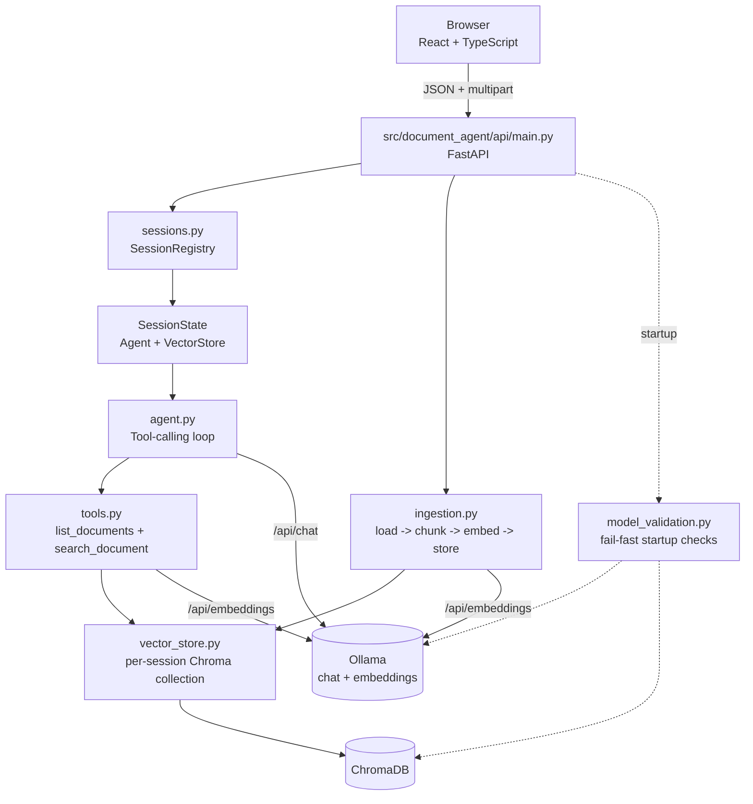
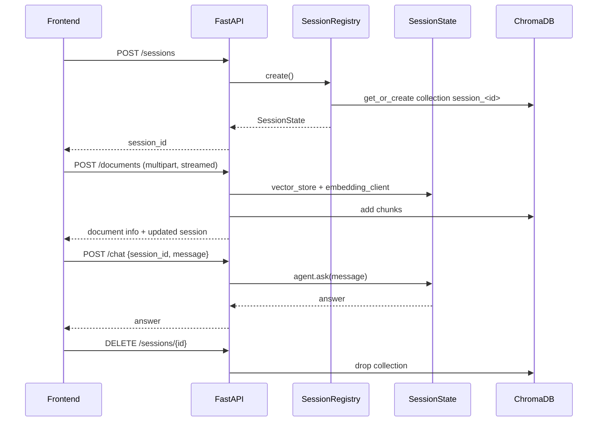
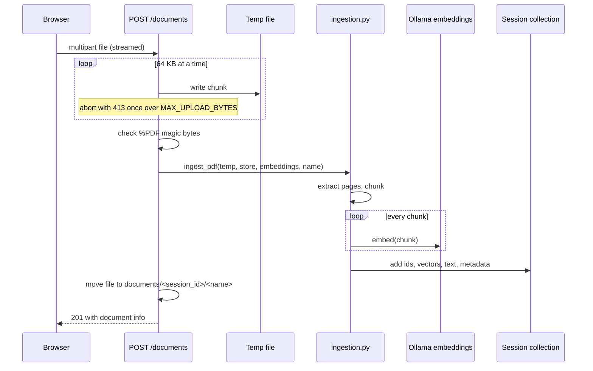

# Local Document Agent

A local retrieval-augmented generation (RAG) application for asking questions
about PDF documents. You upload up to five PDFs into a chat session, ask
questions in the browser, and answers come back grounded in those documents
only:

- **React + TypeScript frontend** for upload (drag and drop), chat, and
  stopping a request in flight.
- **FastAPI backend** owning sessions, streaming uploads, ingestion, and the
  tool-calling agent loop.
- **Ollama** generates answers and creates embeddings - any compatible chat
  and embedding model you have pulled.
- **ChromaDB** stores document chunks, one private collection per session.
- **PyMuPDF** extracts text from PDFs.

Everything runs on your machine. There is no authentication yet: the page is
open to anyone who can reach the port.

## What The Application Does

1. **Session** - the frontend opens a session on load (`POST /sessions`).
   A session owns one conversation and one private vector collection.
2. **Upload** - up to five PDFs per session. Files stream to disk in 64 KB
   chunks, are rejected over the size limit as the bytes arrive, then go
   through the ingestion pipeline: extract text, split into overlapping
   chunks, embed each chunk, store in the session's collection.
3. **Question answering** - a question starts the agent loop. The model can
   call `list_documents` (what is in this session?) and `search_document`
   (retrieve chunks with document names and page numbers). It answers only
   from retrieved text and cites its sources; if retrieval finds nothing, it
   says so instead of guessing.

## Architecture Overview



### The composition roots

`src/document_agent/cli.py` (CLI) and `src/document_agent/api/main.py` (HTTP)
create the concrete
clients, the vector store(s), the `Tools` instance, and register the tools
with an `Agent`. The `Agent` never imports Ollama or ChromaDB - it depends
on the small `ChatClient` interface; tools depend on `EmbeddingProvider` and
`VectorStore`. Swapping providers means writing one adapter and registering
it in a factory.

### Sessions

A session is an in-memory object: an id, a conversation (its `Agent`), a
Chroma collection named `session_<id>`, and a list of uploaded documents.
The registry (`src/sessions.py`) is the only place sessions are created,
found, and destroyed; it is lock-guarded because FastAPI runs sync routes in
a threadpool.



Session state lives in process memory. Restarting the API starts fresh
sessions; the uploaded PDF files remain on disk under `documents/<session>/`.
Removing a document deletes its chunks from Chroma immediately, so it can
never appear in later search results. Deleting a session drops its whole
collection.

## Upload Flow



The size limit is enforced while streaming: an oversized upload is refused
after the limit is crossed, not after the whole file lands. Ingestion runs in
the threadpool, so a slow PDF never blocks other requests.

## Question-Answering And Anti-Hallucination

The agent owns a conversation per session: the system instruction, the chat
history, and the tool results. Each `ask()` gives the model up to
`MAX_TOOL_ROUNDS` chances to call tools; when it replies without tool calls,
that reply is the answer.

Grounding comes from three places:

- **The system prompt** forbids outside knowledge for document questions and
  requires the model to admit when retrieval came up empty.
- **`list_documents`** shows the model exactly which documents exist, so it
  never invents a document that is not there.
- **`search_document`** returns chunks labeled with document name, page
  number, and relevance score, and the prompt requires citing them.

Tool failures are reported back to the model as text (the loop keeps going)
rather than crashing the request.

## Startup Validation (Fail Fast)

Pointing the app at the wrong models is easy - a chat model name pasted into
`EMBEDDING_MODEL_NAME`, a model that was never pulled, Ollama not running.
On startup the API checks all of it and refuses to boot with a readable list
of every problem:

- chat service reachable and `CHAT_MODEL_NAME` present in its model list;
- embedding service reachable, `EMBEDDING_MODEL_NAME` present, and a live
  test embedding succeeds (catches chat-models-used-as-embedders);
- ChromaDB reachable.

Example failure:

```text
Startup validation failed:
  - Cannot reach the chat service at http://localhost:11434 (CHAT_SERVICE_URL). Is Ollama running?
  - Embedding model 'llama3.1:8b' (EMBEDDING_MODEL_NAME) failed a test embedding call: ...
Fix the values in .env (see .env.example) and restart.
```

## API

All errors share one shape: `{"error": {"code": "...", "message": "..."}}`.
`code` is stable and machine-readable; the frontend branches on it (for
example `unknown_session` triggers a fresh session).

| Endpoint                                   | Behavior |
| ------------------------------------------ | -------- |
| `GET /health`                              | Status, configured models, upload limits. |
| `POST /sessions`                           | Create a session; returns `session_id` and `max_documents`. |
| `GET /sessions/{id}`                       | Session with its document list. |
| `DELETE /sessions/{id}`                    | Delete the session and drop its collection. |
| `POST /documents`                          | Multipart upload (`session_id` + `file`), streamed, 2MB default limit. |
| `GET /sessions/{id}/documents`             | List documents in the session. |
| `DELETE /sessions/{id}/documents/{name}`   | Remove a document and all of its vectors. |
| `POST /chat`                               | `{session_id, message}` -> `{answer}`. Waits as long as the model needs. |

Notable error codes: `document_too_large` (413), `unsupported_file_type`
(415), `document_already_exists` / `session_limit_reached` (409),
`ingestion_failed` (422), `unknown_session` / `unknown_document` (404),
`chat_service_unavailable` / `upstream_unavailable` (502).

## Frontend

Vite + React + TypeScript, plain CSS, no runtime dependencies beyond React
itself, native `fetch` only.

```text
frontend/src/
├── constants/api.ts      # every endpoint path, in one place
├── types/api.ts          # wire types matching the Pydantic models
├── lib/http.ts           # the only module that calls fetch
├── lib/errors.ts         # ApiError + abort helpers
├── utils/files.ts        # PDF/size validation, formatBytes
├── hooks/
│   ├── useSession.ts     # create/upload/remove/reset + loading + errors
│   └── useChat.ts        # messages, send, stop (AbortController)
└── components/           # Sidebar, DocumentDropzone, DocumentList,
                          # ChatPanel, MessageList, ChatComposer, Spinner,
                          # WaitingStatus, MessageCitations
```

Conventions (also enforced by the project skill
`.opencode/skills/react-human-code/SKILL.md`): no `React.FC`, early returns
instead of nested ternaries, every API call wrapped in try/catch, one
`AbortController` per request (Stop button + unmount cleanup), no request
timeouts. While the model is thinking the UI shows a spinner and a Stop
button; pressing Stop aborts the HTTP request.

Client-side upload checks (PDF type, size limit) happen before any bytes
leave the browser; the server enforces both again regardless.

## Running The Application

### 1. Services

Ollama and ChromaDB run via Docker Compose. The Ollama container pulls the
models named in your `.env` (`CHAT_MODEL_NAME`, `EMBEDDING_MODEL_NAME`)
automatically on first start:

```bash
docker compose up -d
```

To use different models later, change them in `.env` and pull manually:

```bash
docker exec -it ollama ollama pull <model-name>
```

Only one stack publishing Ollama on port 11434 can run at a time; if you
already run Ollama for another project, skip this step and point that
project's `.env` (or this one's) at the existing service.

### 2. Backend

The project is a proper installable package (`pyproject.toml`, src layout).
One editable install makes everything importable and adds the commands -
no `PYTHONPATH` required:

```bash
python3 -m venv .venv
.venv/bin/python -m pip install -e .    # or: make install
cp .env.example .env                    # adjust model names if needed

.venv/bin/document-agent-api --reload   # or: make api-reload
```

The same API is reachable without the console command:

```bash
.venv/bin/python -m uvicorn document_agent.api.main:app --reload
```

The terminal CLI still works for a single-PDF workflow:

```bash
.venv/bin/document-agent-cli documents/sample.pdf    # or: make cli PDF=documents/sample.pdf
```

Common tasks are also wrapped in a Makefile (`make help` lists them):
`make api`, `make frontend`, `make typecheck`, and so on.

### 3. Frontend

```bash
cd frontend
npm install
npm run dev            # http://localhost:5173, proxies /api routes to :8000
```

The dev server proxies `/health`, `/sessions`, `/documents`, and `/chat` to
`http://localhost:8000` (override with `VITE_BACKEND_ORIGIN`). For a
production build: `npm run build`, then serve `frontend/dist` behind the
same proxy rules, or set `VITE_API_BASE_URL` and allow the origin in
`FRONTEND_ORIGINS`.

## Configuration

Configuration is loaded once from the environment and `.env`:

| Variable                    | Default                  | Meaning |
| --------------------------- | ------------------------ | ------- |
| `CHAT_PROVIDER`             | `ollama`                 | Chat provider selected by the factory. |
| `EMBEDDING_PROVIDER`        | `ollama`                 | Embedding provider selected by the factory. |
| `CHAT_SERVICE_URL`          | `http://localhost:11434` | Chat provider base URL. |
| `EMBEDDING_SERVICE_URL`     | `http://localhost:11434` | Embedding provider base URL. |
| `CHAT_MODEL_NAME`           | `llama3.1:8b`            | Any chat model pulled into Ollama. |
| `EMBEDDING_MODEL_NAME`      | `nomic-embed-text`       | Any embedding model pulled into Ollama. |
| `CHROMA_HOST` / `CHROMA_PORT` | `localhost` / `8001`   | ChromaDB location. |
| `CHROMA_COLLECTION`         | `documents`              | Default collection (the CLI's; sessions use their own). |
| `CHUNK_SIZE` / `CHUNK_OVERLAP` | `800` / `150`         | Character window for chunking. |
| `TOP_K_RESULTS`             | `4`                      | Chunks retrieved per search. |
| `REQUEST_TIMEOUT_SECONDS`   | `0`                      | Ollama timeout; `0` waits indefinitely. |
| `MAX_TOOL_ROUNDS`           | `4`                      | Agent tool-loop budget per question. |
| `MAX_DOCUMENTS_PER_SESSION` | `5`                      | Upload cap per session. |
| `MAX_UPLOAD_MB`             | `2`                      | Upload size cap. |
| `DOCUMENTS_DIR`             | `documents`              | Where uploaded PDFs are archived. |
| `FRONTEND_ORIGINS`          | `http://localhost:5173`  | CORS allow-list (comma-separated). |
| `LOG_LEVEL`                 | `INFO`                   | Logging verbosity. |

Startup validation fails fast on unreachable services or missing/wrong
models, so fix `.env` and restart when that happens.

## Project Structure

```text
local-document-agent/
├── documents/                  # Uploaded PDFs, one folder per session
├── frontend/                   # React + TypeScript UI
│   └── src/
│       ├── components/         # Presentational pieces
│       ├── hooks/              # useSession, useChat
│       ├── lib/                # http + errors (the only fetch calls)
│       ├── constants/          # endpoint paths
│       ├── styles/             # plain CSS
│       └── types/              # API wire types
├── src/
│   └── document_agent/          # installable package (see pyproject.toml)
│       ├── api/
│       │   ├── main.py          # lifespan (validation), CORS, routers
│       │   ├── __main__.py      # document-agent-api console command
│       │   ├── errors.py        # ApiError + handlers -> {"error": {...}}
│       │   ├── schemas.py       # Pydantic request/response models
│       │   ├── deps.py          # shared FastAPI dependencies
│       │   └── routes/          # health, sessions, documents, chat
│       ├── sessions.py          # in-memory SessionRegistry + SessionState
│       ├── model_validation.py  # fail-fast startup checks
│       ├── agent.py             # conversation and tool-calling loop
│       ├── tools.py             # list_documents + search_document
│       ├── vector_store.py      # ChromaDB adapter (per-session collections)
│       ├── ingestion.py         # load -> chunk -> embed -> store
│       ├── chunker.py / document_loader.py
│       ├── embeddings/          # EmbeddingProvider interface + Ollama adapter
│       ├── llm/                 # ChatClient interface + Ollama adapter
│       ├── config.py            # Settings from .env
│       └── cli.py               # document-agent-cli console command
├── pyproject.toml               # packaging, dependencies, console scripts
├── Makefile                     # make install / api / cli / frontend / typecheck
├── .opencode/skills/react-human-code/  # frontend code-style skill
├── docker-compose.yml           # Ollama and ChromaDB
├── requirements.txt             # convenience: installs the project (-e .)
└── .env.example
```

## Current Limitations And Next Steps

- Sessions are in-memory only; a backend restart forgets them (files stay on
  disk). Durable session storage would fix that.
- No authentication or per-user isolation - do not expose the port beyond
  localhost.
- Conversation history grows for the lifetime of a session; there is no
  trimming or summarization yet.
- Chunking is a fixed character window, not structure-aware; scanned PDFs
  need OCR.
- The CLI still talks to the shared `CHROMA_COLLECTION` and remains a
  single-PDF workflow.
- Uploads are archived but there is no re-ingest-from-archive flow; removing
  the last reference to a file deletes it from disk.
